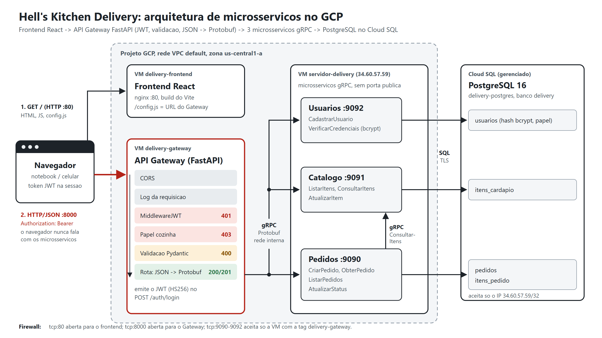

# Delivery Hell's Kitchen - Sistemas Distribuidos 2026/2

Delivery de restaurante com **frontend React**, **API Gateway HTTP/JSON**
(FastAPI, autenticacao JWT) e **tres microsservicos gRPC** (Usuarios, Catalogo e
Pedidos) que persistem em **PostgreSQL**. Cada componente tem a sua imagem
Docker (multi-stage, sem root), e as chamadas entre servicos tem **tolerancia a
falhas**: retry com backoff, circuit breaker, fallback e idempotencia.

Tudo roda no seu computador com `docker compose up` (ver
[Comecando rapido](#comecando-rapido-local-tudo-em-containers)). No Trabalho 2
cada camada rodou em uma VM propria no GCP.

No seu computador (`docker compose`):

```text
 navegador --HTTP :80-->  frontend (nginx sem root)
     |
     +--HTTP/JSON + Bearer :8000-->  gateway (FastAPI)
                                       CORS -> log -> JWT (401) -> papel (403) -> Pydantic (400)
                                       -> retry com backoff + circuit breaker + fallback
                                       |  gRPC / Protobuf (rede interna do compose)
                                       v
                     usuarios :9092    catalogo :9091    pedidos :9090 --gRPC ConsultarItens--> catalogo
                                       |  SQL
                                       v
                     postgres (container)  usuarios, itens_cardapio, pedidos, itens_pedido
```

No Trabalho 2, a mesma arquitetura rodou em 3 VMs no GCP:



```text
 navegador --HTTP :80-->  [VM delivery-frontend]  React servido pelo nginx
     |
     +--HTTP/JSON + Bearer :8000-->  [VM delivery-gateway]  FastAPI
                                       CORS -> log -> JWT (401) -> papel (403) -> Pydantic (400)
                                       |  gRPC / Protobuf pela rede interna da VPC
                                       v
                              [VM servidor-delivery]  usuarios :9092  catalogo :9091  pedidos :9090
                                       |                              ^-- gRPC ConsultarItens --'
                                       |  SQL / TLS
                                       v
                              [Cloud SQL delivery-postgres]  usuarios, itens_cardapio, pedidos, itens_pedido
```

Deploy do Trabalho 2 no GCP (VMs; ligado so para demonstracao, com `scripts/gcp/ligar.ps1`):

| O que | Endereco |
|---|---|
| Frontend | `http://34.72.228.145` |
| API Gateway (Swagger) | `http://34.132.172.125:8000/docs` |

## Stack

| Camada | Tecnologia |
|---|---|
| Frontend | React 18 + Vite 5, servido pelo nginx |
| API Gateway | FastAPI + Pydantic (validacao), PyJWT (HS256), Uvicorn |
| Microsservicos | Python 3.12, gRPC (grpcio 1.68) + Protocol Buffers proto3, bcrypt |
| Banco de dados | PostgreSQL 16 (Cloud SQL no GCP, container no ambiente local), psycopg 3 |
| Execucao | Docker + Docker Compose; um Dockerfile multi-stage por componente (`docker/`, `frontend/Dockerfile`), um profile por papel |
| Tolerancia a falhas | timeout + prazo propagado, retry com backoff exponencial e jitter, circuit breaker por servico, fallback do cardapio, idempotencia, health check gRPC ([docs/07](docs/07-resiliencia.md)) |
| Infraestrutura | 3 VMs no Compute Engine + Cloud SQL + firewall VPC por tag |

## Rotas do Gateway

| Metodo e rota | Token | Microsservico | Sucesso | Erros |
|---|---|---|---|---|
| `POST /auth/cadastro` | nao | Usuarios | **201** | 400, 409 login em uso |
| `POST /auth/login` | nao | Usuarios | 200 + token | 400, **401** senha errada |
| `GET /auth/eu` | sim | - | 200 | 401 |
| `GET /cardapio?categoria=` | sim | Catalogo | 200 | 401, 404 categoria inexistente |
| `PATCH /cardapio/{codigo}` | sim, papel `cozinha` | Catalogo | 200 | 400, 401, **403**, 404 |
| `POST /pedidos` | sim | Pedidos -> Catalogo | **201** (em nome do dono do token) | **400**, 401, 409 item indisponivel, 503 |
| `GET /pedidos?limite=&etapa=&periodo=&item=&cliente=` | sim | Pedidos | 200 (cliente: so os seus; cozinha: todos; filtros opcionais) | 400, 401 |
| `GET /pedidos/eventos` | sim | Pedidos (stream gRPC) | 200, fluxo Server-Sent Events: pedido criado ou etapa alterada, sem F5 | 401 |
| `GET /pedidos/{id}` | sim | Pedidos | 200 (com o horario de cada etapa e a previsao de entrega) | 400, 401, 404 (inclusive pedido de outro cliente) |
| `PATCH /pedidos/{id}/status` | sim, papel `cozinha` | Pedidos | 200 | 400, 401, 403, 404, 409 |
| `GET /saude` | nao | - | 200 (com o estado dos circuitos) | - |
| `GET /saude/servicos` | sim, papel `cozinha` | os tres (health check gRPC) | 200 | 401, 403 |

Sem `Authorization: Bearer <token>` valido, toda rota marcada com token responde
**401** antes de qualquer chamada gRPC. Swagger em `http://HOST:8000/docs`.

Quem se cadastra pela API entra com papel `cliente`. O usuario com papel
`cozinha` (login `professor`) e criado pelo migrador com a senha de `DEMO_SENHA`,
que fica so no `.env` da maquina: nenhuma senha esta no repositorio.

O pedido e sempre feito em nome do dono do token: o corpo do `POST /pedidos` so
tem `endereco` e `itens`, e o Gateway preenche o id e o nome do usuario a partir
do JWT. Cliente lista e consulta so os proprios pedidos; a cozinha ve todos.

Se um microsservico cair, o Gateway repete a chamada com backoff, abre o
circuito depois de 3 falhas seguidas (503 imediato com `Retry-After`) e, no
cardapio, responde com a ultima lista salva. Os outros servicos continuam
funcionando. Ver [docs/07-resiliencia.md](docs/07-resiliencia.md).

## Comecando rapido (local, tudo em containers)

Precisa do Docker Desktop (Windows/macOS) ou Docker Engine + Compose (Linux).

```bash
cp .env.exemplo .env          # PowerShell: Copy-Item .env.exemplo .env ; depois troque DEMO_SENHA
docker compose up -d --build
DEMO_SENHA=<a senha do .env> python scripts/testar_gateway.py --url http://localhost:8000
python scripts/testar_resiliencia.py      # derruba e religa o Catalogo e confere a reacao
```

- O `.env.exemplo` ja vem com `COMPOSE_PROFILES=banco-local,servicos,gateway,frontend`.
- Frontend em `http://localhost` (aba **Saude dos servicos** para acompanhar uma
  falha ao vivo), Gateway em `http://localhost:8000`.
- O teste ponta a ponta roda 46 cenarios (200/201/400/401/403/404/409) e confere
  status e conteudo de cada um, inclusive o dono dos pedidos, os filtros, o
  historico de etapas e a atualizacao em tempo real.

Detalhes em [docs/03-execucao-local.md](docs/03-execucao-local.md).

## Documentacao

| Documento | Conteudo |
|---|---|
| [docs/01-visao-geral-do-sistema.md](docs/01-visao-geral-do-sistema.md) | arquitetura, fluxo de uma requisicao e como o sistema reage a cada situacao |
| [docs/02-contrato-grpc.md](docs/02-contrato-grpc.md) | os tres `.proto` explicados e a geracao dos stubs |
| [docs/03-execucao-local.md](docs/03-execucao-local.md) | subir tudo localmente, testar e consultar o banco |
| [docs/04-deploy-gcp-vm.md](docs/04-deploy-gcp-vm.md) | 3 VMs + Cloud SQL no GCP, firewall, scripts de deploy e liga/desliga |
| [docs/05-api-gateway.md](docs/05-api-gateway.md) | rotas, JWT, papeis, validacao, formato de erro e exemplos |
| [docs/06-frontend.md](docs/06-frontend.md) | telas do frontend, como ele chama o Gateway e como roda |
| [docs/07-resiliencia.md](docs/07-resiliencia.md) | tolerancia a falhas: retry, circuit breaker, fallback, idempotencia e como demonstrar |
| [apresentacao/](apresentacao/) | slides da arquitetura (`.pptx` e `.pdf`) |

O manual do projeto, o prontuario de problemas e o changelog ficam em
[markdown/](markdown/).

## Estrutura

```text
proto/usuarios.proto         contrato do microsservico de Usuarios
proto/catalogo.proto         contrato do microsservico de Catalogo
proto/pedidos.proto          contrato do microsservico de Pedidos
db/schema.sql, db/seed.sql   tabelas e cardapio inicial (idempotentes)
src/gateway/                 API Gateway FastAPI (autenticacao, rotas, esquemas, erros, clientes gRPC)
src/usuarios/                microsservico de Usuarios (servidor, servico, repositorio)
src/catalogo/                microsservico de Catalogo (servidor, servico, repositorio)
src/pedidos/                 microsservico de Pedidos (servidor, servico, repositorio, cliente do Catalogo)
src/comum/                   banco, servidor gRPC, resiliencia (retry + circuit breaker), canal gRPC e log
src/gerado/                  stubs gerados no build (nao versionados)
frontend/                    frontend React (Vite) + Dockerfile (Node no build, nginx sem root na entrega)
docker/                      Dockerfiles multi-stage do Gateway, dos microsservicos e do migrador
requirements/                dependencias Python separadas por papel (gateway, servicos, migrador, build)
scripts/gerar_stubs.py       gera os stubs a partir de proto/*.proto
scripts/migrar_banco.py      aplica db/schema.sql e db/seed.sql
scripts/testar_gateway.py    teste ponta a ponta dos cenarios 200/201/400/401/403/404/409
scripts/testar_resiliencia.py  derruba o Catalogo e confere fallback, 503, isolamento e circuit breaker
scripts/gcp/                 Trabalho 2: criar a infraestrutura das VMs, implantar, ligar, desligar e conferir
docker-compose.yml           profiles servicos, gateway, frontend e banco-local
```

> Os arquivos em `src/gerado/` sao artefato de build: regerados por
> `scripts/gerar_stubs.py` e no `docker build`. Nunca edite a mao.
