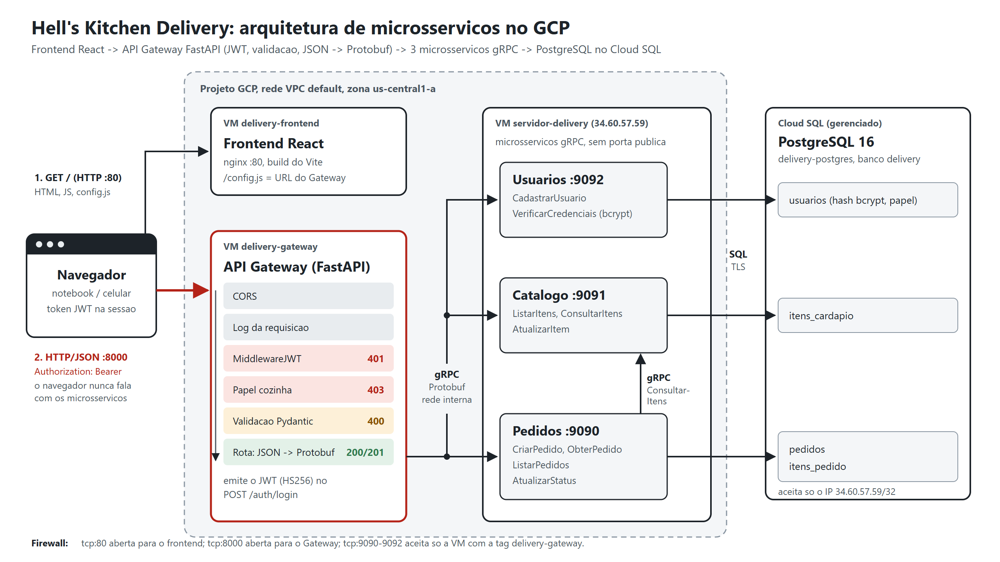

# 1. Visao geral do sistema

## O que o sistema faz

O *Hell's Kitchen* e um restaurante com delivery. Pelo frontend (ou direto pela
API HTTP) e possivel:

- criar conta e entrar (token JWT);
- consultar o cardapio (inteiro ou por categoria);
- montar um pedido com varios itens e a quantidade de cada um, sempre em nome
  de quem esta logado (o nome e o dono vem do token, nao de um campo livre);
- consultar e listar os proprios pedidos (a cozinha ve os de todos);
- com o papel `cozinha`: avancar o status do pedido
  (`RECEBIDO -> EM_PREPARO -> PRONTO -> SAIU_PARA_ENTREGA -> ENTREGUE`), tirar um
  item do cardapio do dia ou mudar o preco.

Tudo o que e consultado, criado ou alterado fica no PostgreSQL. Nao existe lista
estatica nem dicionario em memoria: reiniciar qualquer container nao perde nada.



## Componentes

| Componente | Papel | Protocolo de entrada | Dono de | Onde roda no GCP |
|---|---|---|---|---|
| **Frontend** (`frontend/`) | telas para o usuario; so conversa com o Gateway | HTTP na porta 80 (publica) | - | VM `delivery-frontend` |
| **Gateway** (`src/gateway/`) | ponto unico de entrada; autentica o JWT, confere o papel, valida o JSON, traduz para Protobuf e despacha | HTTP/JSON na porta 8000 (publica) | nenhuma tabela | VM `delivery-gateway` |
| **Usuarios** (`src/usuarios/`) | cadastro e conferencia de login e senha (bcrypt) | gRPC na porta 9092 (so o Gateway) | `usuarios` | VM `servidor-delivery` |
| **Catalogo** (`src/catalogo/`) | cardapio: listar, consultar por codigo, alterar disponibilidade/preco | gRPC na porta 9091 (so o Gateway) | `itens_cardapio` | VM `servidor-delivery` |
| **Pedidos** (`src/pedidos/`) | cria, consulta, lista e avanca pedidos; consulta o Catalogo para precificar | gRPC na porta 9090 (so o Gateway) | `pedidos`, `itens_pedido` | VM `servidor-delivery` |
| **PostgreSQL** | persistencia | SQL na porta 5432 (TLS) | - | Cloud SQL `delivery-postgres` |
| **Migrador** | cria as tabelas e carrega a carga inicial a cada deploy e depois termina | - | - | VM `servidor-delivery` |

Cada microsservico so le e escreve as proprias tabelas. Pedidos nao faz `SELECT`
em `itens_cardapio`: ele pergunta ao Catalogo por gRPC. Por isso a linha do
pedido guarda uma copia do nome e do preco no momento da compra (snapshot):
mudar o preco no Catalogo depois nao altera pedidos antigos.

## Login e token

```text
1. navegador  --POST /auth/login {login, senha}-->  gateway
2. gateway    --gRPC UsuarioService.VerificarCredenciais-->  usuarios  --SELECT-->  usuarios
3. usuarios: bcrypt.checkpw(senha, senha_hash)
             errado -> UNAUTHENTICATED -> gateway responde 401
4. gateway: assina o JWT (HS256, JWT_SEGREDO) com sub, login, nome, papel, iat, exp
5. navegador guarda o token e manda "Authorization: Bearer <token>" em toda chamada
```

O token e emitido e conferido so no Gateway. Os microsservicos nao veem token:
quando a chamada chega neles, o Gateway ja autenticou e autorizou.

## Caminho de um `POST /pedidos`

```text
1. navegador  --HTTP POST /pedidos {endereco, itens} + Bearer-->  gateway
2. gateway: MiddlewareJWT confere assinatura e validade
            sem token, token invalido ou expirado -> 401 (nao chega nos microsservicos)
3. gateway: Pydantic valida o payload (campo "cliente" no corpo -> 400)
            invalido -> 400 {"mensagem", "erros": {campo: motivo}}
4. gateway: monta o CriarPedidoRequest com usuario_id = sub do token, cliente =
            nome do token e um pedido_id novo (chave de idempotencia)
5. gateway  --gRPC PedidoService.CriarPedido (Protobuf, com retry)-->  pedidos
6. pedidos  --gRPC CatalogoService.ConsultarItens (com retry)-->  catalogo  --SELECT-->  itens_cardapio
7. pedidos: confere existencia/disponibilidade, calcula subtotal, total e tempo
8. pedidos  --INSERT pedidos + itens_pedido (uma transacao)-->  PostgreSQL
9. pedidos  --Pedido (Protobuf)-->  gateway  --201 Created {JSON}-->  navegador
```

Se o Catalogo nao responde no passo 6, o Pedidos tenta de novo com backoff e,
sem sucesso, responde 503 sem gravar nada. O que acontece em cada tipo de falha
esta em [07-resiliencia.md](07-resiliencia.md).

## Dono do pedido

| Papel | `POST /pedidos` | `GET /pedidos` | `GET /pedidos/{id}` |
|---|---|---|---|
| `cliente` | grava em nome do dono do token | so os proprios pedidos (`"escopo": "meus"`) | so se o pedido for dele; de outro usuario responde 404 |
| `cozinha` | grava em nome do dono do token | todos (`"escopo": "todos"`) | qualquer pedido |

O Gateway tira o `usuario_id` e o nome do token assinado e manda para o Pedidos
no Protobuf; o corpo HTTP nao tem como escolher em nome de quem o pedido e feito.
O filtro e feito no banco (`WHERE usuario_id = ...`), pelo Pedidos.

## Como o sistema reage

| Situacao | Quem detecta | gRPC | HTTP | Mensagem |
|---|---|---|---|---|
| sem cabecalho `Authorization` | Gateway (MiddlewareJWT) | - | 401 | `Token ausente. Envie o cabecalho Authorization: Bearer <token>.` |
| cabecalho sem `Bearer` | Gateway | - | 401 | `Cabecalho Authorization invalido. Use: Bearer <token>.` |
| token adulterado ou de outro segredo | Gateway | - | 401 | `Token invalido.` |
| token vencido | Gateway | - | 401 | `Token expirado. Faca login novamente.` |
| login ou senha errados | Usuarios | `UNAUTHENTICATED` | 401 | `Login ou senha invalidos.` |
| cliente tentando alterar cardapio ou status | Gateway (`exigir_papel`) | - | 403 | `Operacao permitida so para o papel 'cozinha'.` |
| login ja cadastrado | Usuarios | `ALREADY_EXISTS` | 409 | `O login 'maria' ja esta em uso.` |
| login fora do formato (`a b`) | Gateway | - | 400 | `use de 3 a 30 letras, numeros, ponto ou sublinhado (ex.: maria.silva)` |
| senha curta | Gateway | - | 400 | `deve ter pelo menos 6 caracteres` |
| JSON malformado | Gateway (Pydantic) | - | 400 | `erros.<campo>: "JSON malformado"` |
| `endereco` ausente | Gateway | - | 400 | `erros.endereco: "campo obrigatorio"` |
| `endereco` so com espacos | Gateway | - | 400 | `erros.endereco: "nao deve estar vazio"` |
| `cliente` no corpo do pedido | Gateway | - | 400 | `erros.cliente: "campo nao permitido"` (o nome vem do token) |
| cliente pedindo pedido de outro usuario | Pedidos (filtro pelo dono) | `NOT_FOUND` | 404 | `Pedido '...' nao encontrado.` |
| `itens` vazio | Gateway | - | 400 | `erros.itens: "deve ter pelo menos um item"` |
| `quantidade` <= 0 | Gateway | - | 400 | `erros.itens.0.quantidade: "deve ser maior que zero"` |
| `quantidade` nao inteira (`"2"`, `1.5`) | Gateway | - | 400 | `"deve ser um numero inteiro"` |
| codigo fora do formato (`P1`) | Gateway | - | 400 | `"codigo invalido: use 2 letras e 2 digitos (ex.: PR01)"` |
| campo desconhecido (ex.: `preco`) | Gateway | - | 400 | `"campo nao permitido"` |
| codigo valido mas inexistente (`XX99`) | Pedidos (via Catalogo) | `INVALID_ARGUMENT` | 400 | `Item 'XX99' nao existe no cardapio.` |
| item indisponivel (`PR05` na carga inicial) | Pedidos | `FAILED_PRECONDITION` | 409 | `Item 'PR05' (Moqueca de peixe) esta indisponivel hoje.` |
| refrigerante (`BE01`) ou agua (`BE03`) sem escolher a opcao | Pedidos (via Catalogo) | `INVALID_ARGUMENT` | 400 | `Escolha uma opcao para BE01 (Refrigerante lata): Coca-Cola, ...` |
| opcao que nao existe, ou opcao num prato sem opcoes | Pedidos (via Catalogo) | `INVALID_ARGUMENT` | 400 | `Opcao 'Fanta Morango' nao existe para BE01 (...)` |
| pedido inexistente | Pedidos | `NOT_FOUND` | 404 | `Pedido '...' nao encontrado.` |
| id de pedido malformado | Pedidos | `INVALID_ARGUMENT` | 400 | `Id de pedido invalido: '...'.` |
| pular ou voltar etapa do status | Pedidos | `FAILED_PRECONDITION` | 409 | `Nao e possivel mudar de EM_PREPARO para ENTREGUE: a proxima etapa e PRONTO.` |
| status fora da lista | Gateway | - | 400 | `"valor nao permitido; use um de: RECEBIDO, ..."` |
| categoria inexistente | Catalogo | `NOT_FOUND` | 404 | `Categoria 'Pizzas' nao existe no cardapio.` |
| Catalogo fora do ar ao criar pedido | Pedidos (depois do retry) | `UNAVAILABLE` | 503 + `Retry-After` | `Catalogo indisponivel no momento (...): nao foi possivel confirmar os itens.` |
| Catalogo fora do ar ao listar o cardapio | Gateway | `UNAVAILABLE` | 200 | lista salva, com `"origem": "cache"` e `"aviso"` |
| microsservico fora do ar | Gateway (depois do retry) | `UNAVAILABLE` | 503 + `Retry-After` | detalhe do gRPC |
| 3 falhas seguidas do mesmo servico | Gateway (circuit breaker) | - | 503 imediato | `Servico de catalogo temporariamente indisponivel (circuito aberto)...` |

A validacao de negocio existe nas duas camadas: o Gateway barra payload
invalido na borda, e o microsservico repete as checagens essenciais para nao
depender de quem o chama (defesa em profundidade).

## Decisoes de projeto

| Decisao | Motivo |
|---|---|
| FastAPI + Pydantic no Gateway | a validacao do payload fica declarada nos modelos (`src/gateway/esquemas.py`), e o Swagger em `/docs` sai de graca para a demonstracao |
| 400 no lugar do 422 padrao do FastAPI | o requisito pede `400 Bad Request` para dado invalido; o handler de `RequestValidationError` e sobrescrito em `src/gateway/erros.py` |
| JWT conferido num middleware, nao em cada rota | a borda barra tudo que nao tem token valido; uma rota nova ja nasce protegida, e so as rotas da lista `ROTAS_PUBLICAS` passam sem token |
| Senha so no microsservico de Usuarios, com bcrypt | o Gateway nunca toca no banco; no banco fica so o hash |
| Papel no token (`cliente`/`cozinha`) | quem se cadastra pela API nao pode mudar preco nem status; o 403 sai do Gateway sem ir ao microsservico |
| Um `.proto` por microsservico | cada servico tem o proprio contrato; o Gateway e o Pedidos importam so os stubs que usam |
| Pedidos chama Catalogo por gRPC | comunicacao entre microsservicos e dono unico de cada tabela |
| SQL puro com psycopg 3 (sem ORM) | as consultas ficam visiveis no repositorio de cada servico (`repositorio.py`) |
| Um banco, tabelas separadas por dono | uma unica instancia Cloud SQL mantem o custo baixo sem misturar responsabilidades |
| Status avanca so para a proxima etapa | evita estados impossiveis; o `UPDATE` e condicional (`WHERE status = atual`) para duas chamadas simultaneas nao avancarem duas vezes |
| Dono do pedido vem do token | o professor apontou que o nome do cliente era texto livre e a lista nao filtrava pelo usuario; agora o pedido guarda o `usuario_id` do token e o cliente so ve os seus |
| Retry, circuit breaker e fallback no cliente gRPC | uma falha de um microsservico nao derruba o sistema inteiro nem trava o usuario (ver [07-resiliencia.md](07-resiliencia.md)) |
| Tempo real com NOTIFY + gRPC streaming + SSE | a tela acompanha o pedido sem F5; o aviso nasce no banco (funciona com varias instancias) e o Gateway abre um so stream por instancia, nao um por navegador |
| Opcoes do item no Catalogo, conferidas pelo Pedidos | o sabor do refrigerante e dado do cardapio (`itens_cardapio.opcoes`), nao regra fixa no codigo; a cozinha ou a carga mudam as opcoes sem mexer no Pedidos |
| Rastreamento com OpenTelemetry | o mesmo codigo manda os spans para o Jaeger no computador e para o Cloud Trace no Google Cloud (ver [08-rastreamento.md](08-rastreamento.md)) |
| Historico de etapas em tabela propria | `etapas_pedido` guarda o horario de cada etapa (para a linha do tempo do pedido) sem mudar a tabela `pedidos` |
| Uma VM por camada | frontend, Gateway e microsservicos sobem e caem de forma independente; as portas gRPC so aceitam a VM do Gateway |
