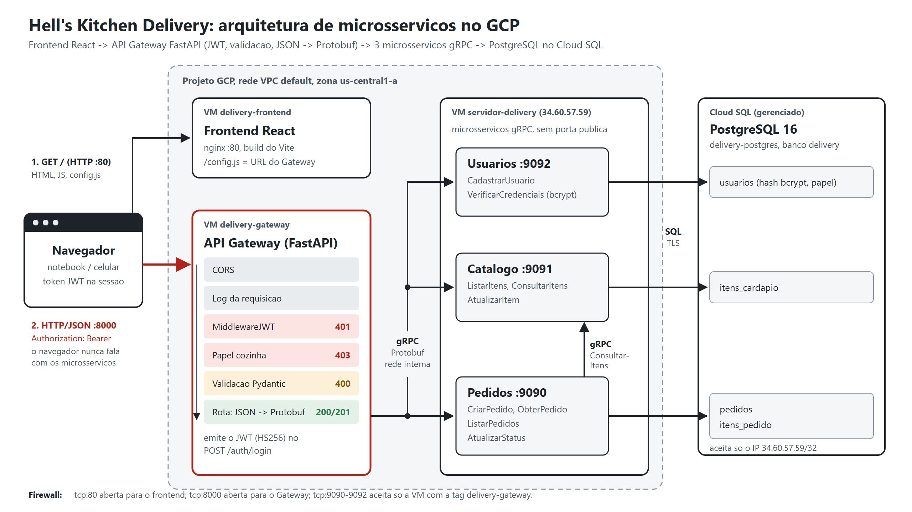

# 4. Deploy no GCP: 3 VMs + Cloud SQL

Infraestrutura do projeto `sistemas-distribuidos-505422`, regiao `us-central1`,
zona `us-central1-a`. Cada camada roda em uma VM propria, todas com o mesmo
repositorio e o mesmo `docker-compose.yml`. O `COMPOSE_PROFILES` do `.env` de
cada VM escolhe o que ela sobe.



| Recurso | Nome | Detalhe |
|---|---|---|
| VM do frontend | `delivery-frontend` | `e2-small`, Debian 12, tag `delivery-frontend`, IP estatico `ip-delivery-frontend` = `34.72.228.145`, profile `frontend` (nginx na 80) |
| VM do Gateway | `delivery-gateway` | `e2-small`, Debian 12, tag `delivery-gateway`, IP estatico `ip-delivery-gateway` = `34.132.172.125`, profile `gateway` (FastAPI na 8000) |
| VM dos microsservicos | `servidor-delivery` | `e2-small`, Debian, tag `delivery-servicos`, IP estatico `ip-servidor-delivery` = `34.60.57.59`, profile `servicos` (usuarios 9092, catalogo 9091, pedidos 9090, migrador) |
| Banco | `delivery-postgres` (Cloud SQL) | PostgreSQL 16, Enterprise, `db-f1-micro`, IP publico `34.63.128.138`, banco `delivery`, rede autorizada `34.60.57.59/32` |

| Regra de firewall | Acao | Prioridade | Portas | Origem | Alvo (tag) |
|---|---|---|---|---|---|
| `delivery-frontend-http` | ALLOW | 1000 | `tcp:80` | `0.0.0.0/0` | `delivery-frontend` |
| `delivery-gateway-http` | ALLOW | 1000 | `tcp:8000` | `0.0.0.0/0` | `delivery-gateway` |
| `delivery-grpc-interno` | ALLOW | 800 | `tcp:9090-9092` | **tag** `delivery-gateway` | `delivery-servicos` |
| `delivery-grpc-bloqueio` | DENY | 900 | `tcp:9090-9092` | `0.0.0.0/0` | `delivery-servicos` |

- **So a VM do Gateway alcanca os microsservicos.** A rede `default` tem a regra
  `default-allow-internal` (prioridade 65534), que libera qualquer porta entre
  VMs da VPC. O ALLOW da tag `delivery-gateway` (800) vale antes do DENY geral
  (900), que vale antes da regra padrao: o Gateway entra, qualquer outra origem
  (internet, VM do frontend, outras VMs do projeto) e recusada. A regra usa a tag
  de origem, nao um IP: vale para o IP interno da VM do Gateway, seja ele qual for.
- **O Gateway chama os microsservicos pelo DNS interno da VPC**
  (`servidor-delivery.us-central1-a.c.sistemas-distribuidos-505422.internal`),
  entao nao depende do IP interno da VM.
- **So a VM `servidor-delivery` conecta no banco.** O Cloud SQL aceita apenas o IP
  dela; o Gateway e o frontend nao tem credencial nem rota para o banco.
- **IPs estaticos** nas tres VMs: a URL do frontend, a do Gateway (que vai no
  `config.js` do frontend e no `CORS_ORIGENS`) e a rede autorizada do Cloud SQL
  nao mudam quando as VMs sao religadas. IP estatico reservado cobra um valor
  pequeno por hora tambem com a VM parada.

Os comandos abaixo rodam no notebook (Windows/PowerShell), com o `gcloud`
autenticado na conta do projeto (`gcloud auth login`). Todos os scripts passam
`--project sistemas-distribuidos-505422`, entao nao importa qual e o projeto
padrao do `gcloud`.

---

## Etapa 1 - Criar o que falta (uma vez)

```powershell
powershell -ExecutionPolicy Bypass -File scripts\gcp\criar_infra.ps1
```

O script e idempotente (o que ja existe e mantido) e faz:

1. reserva os IPs `ip-delivery-gateway` e `ip-delivery-frontend`;
2. cria as quatro regras de firewall da tabela acima;
3. cria as VMs `delivery-gateway` e `delivery-frontend` com o startup-script
   `scripts/gcp/instalar_docker.sh`, que instala Docker (repositorio oficial,
   com o plugin compose) e Git no primeiro boot;
4. na VM `servidor-delivery`, adiciona a tag `delivery-servicos` e remove
   `portas-trabalho-sd`, `http-server` e `https-server` (ela deixa de ter porta
   publica).

No fim ele lista as VMs com IP interno, IP externo e tags.

## Etapa 2 - Implantar o codigo nas VMs

As VMs precisam estar ligadas, e a branch precisa estar publicada no GitHub.

```powershell
powershell -ExecutionPolicy Bypass -File scripts\gcp\implantar.ps1
```

Para cada VM, nesta ordem (microsservicos, Gateway, frontend), o script entra por
SSH como `maia_matheus` e roda `scripts/gcp/preparar_vm.sh` com o papel da VM:

| VM | Papel | O que o `preparar_vm.sh` grava no `.env` |
|---|---|---|
| `servidor-delivery` | `servicos` | `COMPOSE_PROFILES=servicos`, `GRPC_BIND=0.0.0.0`, `DEMO_LOGIN=professor` e um `DEMO_SENHA` gerado na primeira vez (mantem os `DB_*` que ja estao la) e remove o container `delivery-gateway` antigo |
| `delivery-gateway` | `gateway` | `COMPOSE_PROFILES=gateway`, `USUARIOS_HOST`/`CATALOGO_HOST`/`PEDIDOS_HOST` = DNS interno do `servidor-delivery`, `CORS_ORIGENS=http://<IP do frontend>` e um `JWT_SEGREDO` gerado na primeira vez |
| `delivery-frontend` | `frontend` | `COMPOSE_PROFILES=frontend`, `API_URL=http://<IP do Gateway>:8000` |

Depois ele roda `docker compose up -d --build --remove-orphans`. O script pode
rodar de novo a cada atualizacao do codigo; para uma VM so:

```powershell
powershell -ExecutionPolicy Bypass -File scripts\gcp\implantar.ps1 -Somente gateway
```

- O `.env` de cada VM fica so na VM (esta no `.gitignore`). A senha do banco e a
  do usuario `professor` (papel `cozinha`) estao so no `.env` do
  `servidor-delivery`, e o `JWT_SEGREDO` so no do Gateway. Para ver a senha da
  cozinha:

  ```powershell
  gcloud compute ssh maia_matheus@servidor-delivery --zone us-central1-a --project sistemas-distribuidos-505422 --command "grep DEMO_SENHA ~/sd-2026-2/.env"
  ```

  Os scripts `ligar.ps1` e `status.ps1` fazem essa leitura sozinhos e guardam a
  senha em `$env:DEMO_SENHA` na sessao do PowerShell.
- A branch padrao e `trabalho-parte2`; depois do merge, use `-Branch main`.

## Etapa 3 - Conferir

```powershell
powershell -ExecutionPolicy Bypass -File scripts\gcp\status.ps1
```

Saida esperada (os IPs das VMs novas aparecem na tabela de recursos):

```text
== Camadas
   Frontend (http://34.72.228.145)       OK  200
   config.js do frontend               OK  window.API_URL = 'http://34.132.172.125:8000';
   Gateway /saude                      OK  ok
   Sem token -> 401                    OK  401
   Login + cardapio (gRPC + banco)     OK  13 itens
   gRPC fechado para a internet        OK  34.60.57.59:9090 sem resposta
```

Teste completo a partir do notebook:

```powershell
python scripts\testar_gateway.py --url http://34.132.172.125:8000 --resumido   # usa $env:DEMO_SENHA
```

Deve terminar com `Todos os cenarios passaram.`

## Etapa 4 - Ligar e desligar (para economizar credito)

Os containers tem `restart: always` e o Docker sobe com a VM. Ao religar, tudo
volta sozinho, sem SSH.

```powershell
powershell -ExecutionPolicy Bypass -File scripts\gcp\ligar.ps1
powershell -ExecutionPolicy Bypass -File scripts\gcp\desligar.ps1
```

- `ligar.ps1` liga o **Cloud SQL primeiro** e espera `RUNNABLE`, depois as tres
  VMs, e so termina quando o Gateway responde `/saude`, o login (Usuarios) e o
  cardapio (Catalogo) leem o banco, e o frontend responde.
- `desligar.ps1` para as VMs e poe o Cloud SQL em `activation-policy=NEVER`.
- **Nao use `docker compose down`** no ciclo normal: ele remove os containers,
  e container removido nao volta no boot.

## Etapa 5 - Ver os dados no Cloud SQL Studio

Console > **Cloud SQL** > `delivery-postgres` > **Cloud SQL Studio**. Faca login
com banco **`delivery`** (nao o `postgres`), usuario `postgres` e a senha do
banco. Depois consulte:

```sql
SELECT login, nome, papel, left(senha_hash, 7) AS hash, criado_em FROM usuarios ORDER BY criado_em DESC;
SELECT id, cliente, status, total, criado_em, atualizado_em FROM pedidos ORDER BY criado_em DESC;
SELECT * FROM itens_pedido;
SELECT codigo, nome, preco, disponivel, atualizado_em FROM itens_cardapio ORDER BY codigo;
```

## Logs ao vivo

Cada VM mostra a parte dela da requisicao:

```powershell
gcloud compute ssh maia_matheus@delivery-gateway --zone us-central1-a --project sistemas-distribuidos-505422 --command "cd ~/sd-2026-2 && sudo docker compose logs -f --tail 0 gateway"
gcloud compute ssh maia_matheus@servidor-delivery --zone us-central1-a --project sistemas-distribuidos-505422 --command "cd ~/sd-2026-2 && sudo docker compose logs -f --tail 0 usuarios catalogo pedidos"
```

Ou pelo botao **SSH** do Console (entra como `maia_matheus`) e
`cd ~/sd-2026-2 && sudo docker compose logs -f --tail 0`.

## Problemas comuns

| Sintoma | Causa provavel | Acao |
|---|---|---|
| `503` com `UNAVAILABLE` em toda rota com token | Gateway nao alcanca o `servidor-delivery` | VM parada, `GRPC_BIND` sem `0.0.0.0` no `.env` dela, ou firewall `delivery-grpc-interno` / tags faltando (`status.ps1` e `gcloud compute instances list --format="table(name,tags.items.list())"`) |
| `Banco indisponivel (tentativa N/30)` nos logs do `servidor-delivery` | Cloud SQL ainda ligando | esperar `RUNNABLE`; o `ligar.ps1` ja espera |
| Frontend abre, mas toda acao da "Gateway fora do ar" | `API_URL` errado no `.env` do frontend, ou Gateway parado | `curl http://34.72.228.145/config.js` e `curl http://34.132.172.125:8000/saude` |
| No navegador: erro de CORS no console | `CORS_ORIGENS` do Gateway nao tem a URL exata do frontend | `implantar.ps1 -Somente gateway` regrava com o IP do frontend |
| Todo mundo deslogado depois de religar | `JWT_SEGREDO` saiu do `.env` do Gateway | conferir o `.env`; o `preparar_vm.sh` so gera o segredo se ele nao existir |
| `curl` na 8000 ou na 80 da timeout | VM parada ou sem a tag da regra | `gcloud compute instances describe NOME --zone us-central1-a --format="get(tags.items)"` |
| containers sumiram apos religar | foi usado `docker compose down` | `implantar.ps1 -Somente <papel>` |

## Referencia: o Cloud SQL

A instancia ja existe. Foi criada assim:

```bash
gcloud services enable sqladmin.googleapis.com --project sistemas-distribuidos-505422

gcloud sql instances create delivery-postgres \
  --database-version=POSTGRES_16 --edition=ENTERPRISE --tier=db-f1-micro \
  --region=us-central1 --availability-type=zonal \
  --storage-size=10 --storage-type=HDD --no-backup \
  --authorized-networks=34.60.57.59/32 \
  --project sistemas-distribuidos-505422

gcloud sql databases create delivery --instance=delivery-postgres --project sistemas-distribuidos-505422
gcloud sql users set-password postgres --instance=delivery-postgres \
  --password='SENHA_DO_BANCO' --project sistemas-distribuidos-505422
```

O `.env` do `servidor-delivery` aponta para ela:

```bash
COMPOSE_PROFILES=servicos
GRPC_BIND=0.0.0.0
DB_HOST=34.63.128.138
DB_PORT=5432
DB_NAME=delivery
DB_USER=postgres
DB_PASSWORD=SENHA_DO_BANCO
DB_SSLMODE=require
DEMO_LOGIN=professor
DEMO_SENHA=gerada-pelo-preparar_vm
```

## Encerrar de vez (depois da entrega)

```powershell
$P = "--project=sistemas-distribuidos-505422"
gcloud compute instances delete delivery-frontend delivery-gateway servidor-delivery --zone us-central1-a $P
gcloud compute addresses delete ip-delivery-frontend ip-delivery-gateway ip-servidor-delivery --region us-central1 $P
gcloud compute firewall-rules delete delivery-frontend-http delivery-gateway-http delivery-grpc-interno delivery-grpc-bloqueio $P
gcloud sql instances delete delivery-postgres $P
```
