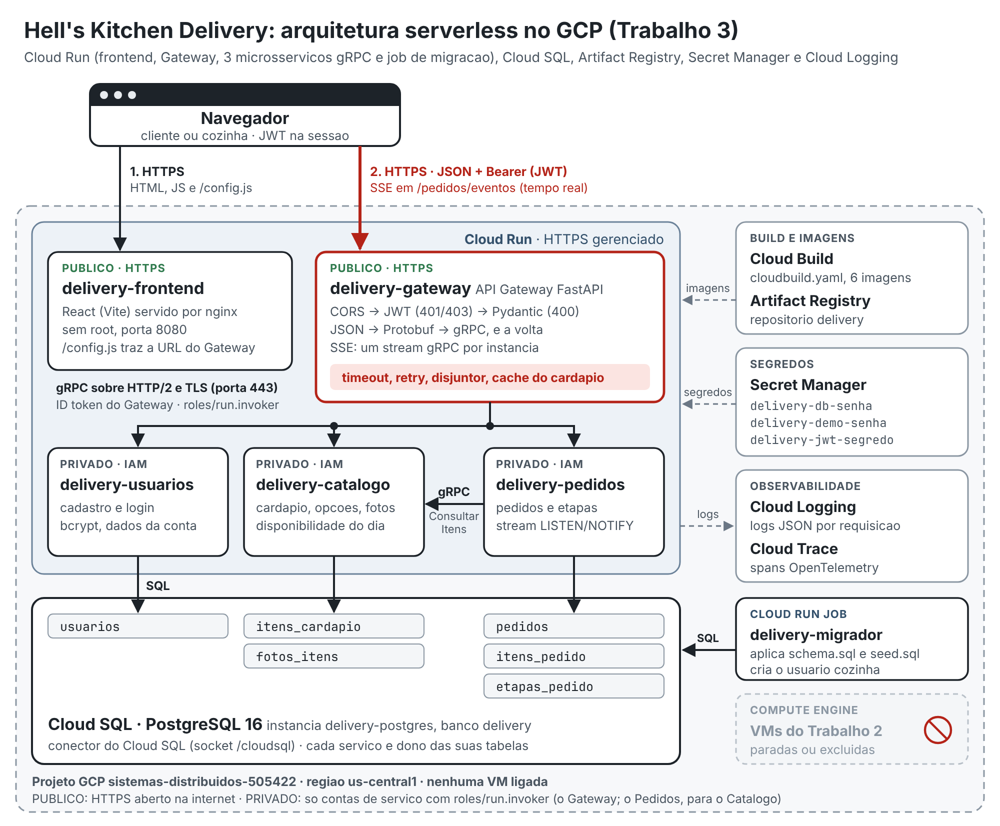

# 9. Implantacao no Google Cloud (Cloud Run)

> **Status:** implantado em 11/11/2026 no projeto `sistemas-distribuidos-505422`
> pelo Cloud Shell, com `scripts/gcp/cloud-run/implantar.sh` (passo a passo
> abaixo). Fora dos testes e da apresentacao o Cloud SQL fica desligado
> (`desligar.sh`): antes de usar, rode `ligar.sh`.

| Servico | Acesso | URL |
|---|---|---|
| `delivery-frontend` | publico | https://delivery-frontend-j76gmjruwa-uc.a.run.app |
| `delivery-gateway` | publico (Swagger em `/docs`) | https://delivery-gateway-j76gmjruwa-uc.a.run.app |
| `delivery-usuarios` | privado (gRPC, IAM) | https://delivery-usuarios-j76gmjruwa-uc.a.run.app |
| `delivery-catalogo` | privado (gRPC, IAM) | https://delivery-catalogo-j76gmjruwa-uc.a.run.app |
| `delivery-pedidos` | privado (gRPC, IAM) | https://delivery-pedidos-j76gmjruwa-uc.a.run.app |

## Cada componente num servico gerenciado



Fonte editavel do diagrama: [arquitetura-cloud-run.svg](arquitetura-cloud-run.svg). O
relatorio tecnico do Trabalho 3 fica em
[apresentacao/Trabalho3-relatorio.html](../apresentacao/Trabalho3-relatorio.html): abra no
Chrome, Ctrl+P, "Salvar como PDF", papel A4, com "Graficos de plano de fundo"
marcado. Os links da tabela da secao 5 saem do fim do `implantar.sh`.

| Componente | No seu computador | No Google Cloud |
|---|---|---|
| Frontend | container nginx | Cloud Run `delivery-frontend`, publico (HTTPS) |
| Gateway | container | Cloud Run `delivery-gateway`, publico (HTTPS) |
| Usuarios, Catalogo, Pedidos | containers | Cloud Run `delivery-usuarios`, `delivery-catalogo`, `delivery-pedidos`, gRPC com HTTP/2 (`--use-http2`), **privados**: so quem tem o papel `roles/run.invoker` chama (o Gateway; o Pedidos no Catalogo) |
| Migrador | container que roda e termina | Cloud Run **job** `delivery-migrador`, executado a cada implantacao |
| PostgreSQL | container | Cloud SQL `delivery-postgres` (o do Trabalho 2), pelo conector do Cloud Run (`DB_HOST=/cloudsql/<conexao>`) |
| Imagens | build local | Cloud Build (`scripts/gcp/cloud-run/cloudbuild.yaml`) publica no Artifact Registry `us-central1-docker.pkg.dev/<projeto>/delivery/<componente>` |
| Senhas | `.env` | **Secret Manager** |
| Fotos dos pratos | tabela `fotos_itens` do PostgreSQL | a mesma tabela no Cloud SQL (o container do Cloud Run nao guarda arquivo) |
| Logs | `docker compose logs` | Cloud Logging (`LOG_JSON=1`) |
| Traces | Jaeger | **Cloud Trace** (`RASTREAMENTO=gcp`, ver [08-rastreamento.md](08-rastreamento.md)) |
| VMs do Trabalho 2 | - | paradas ou excluidas (`desligar.sh`) |

## Implantar (Cloud Shell, uns 20 minutos)

O Cloud Shell e um terminal no navegador, ja com o `gcloud` autenticado com a
sua conta: nao precisa instalar nada no computador.

1. Abra o console no projeto `sistemas-distribuidos-505422` e clique no icone
   **Ativar o Cloud Shell** (`>_`, no alto a direita).
2. Baixe o codigo:

   ```bash
   git clone https://github.com/matheus14maia/sd-2026-2.git
   ```
   ```bash
   cd sd-2026-2
   ```

   Se a pasta `sd-2026-2` ja existe no Cloud Shell (de uma implantacao
   anterior), entre nela e atualize com `git checkout main` e `git pull`.

3. Rode a implantacao:

   ```bash
   bash scripts/gcp/cloud-run/implantar.sh
   ```

   Ele so pergunta a **senha da cozinha** (login `professor`, 6 ou mais
   caracteres). As outras senhas sao sorteadas e guardadas no Secret Manager.
   No fim aparece a tabela com o link HTTPS de cada servico (a mesma que vai no
   relatorio).
4. Abra o link do `delivery-frontend` e teste. Para os 84 cenarios:

   ```bash
   python3 scripts/testar_gateway.py --url <link do delivery-gateway> --resumido --senha <senha da cozinha>
   ```

   O banco do Cloud SQL guarda o que a cozinha mudou pela tela (a carga inicial
   nunca mexe em disponibilidade). Por isso o teste acerta antes os itens que
   usa (PR01, PR05, BE01, BE02 e BE03) e, no fim, devolve o que a cozinha tinha
   deixado. As contas e os pedidos de teste ficam no banco.

5. **Ao terminar, desligue** (para o Cloud SQL nao ficar cobrando):

   ```bash
   bash scripts/gcp/cloud-run/desligar.sh
   ```

O script pode rodar de novo a qualquer momento (depois de um `git pull`): o que
ja existe e reaproveitado e cada servico ganha uma revisao nova com o codigo
atual.

| Etapa do `implantar.sh` | O que faz |
|---|---|
| 1. APIs | liga Cloud Run, Artifact Registry, Cloud Build, Cloud SQL Admin, Secret Manager, Cloud Trace, IAM e Logging |
| 2. Artifact Registry | cria o repositorio Docker `delivery` |
| 3. Cloud SQL | liga a instancia `delivery-postgres` (ou cria, se nao existir) e o banco `delivery` |
| 4. Secret Manager | `delivery-db-senha` (sorteia uma senha nova para o usuario `postgres`; para manter a atual, rode com `SENHA_BANCO=<senha>`), `delivery-demo-senha` (a que voce digitou) e `delivery-jwt-segredo` (sorteado) |
| 5. Contas de servico | `delivery-gateway`, `delivery-servicos` e `delivery-frontend`, cada uma so com os papeis que precisa; a conta do Cloud Build ganha permissao para publicar as imagens |
| 6. Imagens | `gcloud builds submit` com o `cloudbuild.yaml`: as seis imagens em paralelo, bases do espelho `mirror.gcr.io` (o Docker Hub limita downloads), etiqueta = commit atual |
| 7. Migrador | job `delivery-migrador`: tabelas, cardapio e usuario da cozinha |
| 8. Microsservicos | Catalogo, Usuarios e Pedidos privados; o Gateway pode chamar os tres e o Pedidos pode chamar o Catalogo |
| 9. Gateway e frontend | publicos; o `API_URL` do frontend aponta para o Gateway e o `CORS_ORIGENS` do Gateway para o frontend |

## Antes e depois de usar (custo)

| Situacao | Comando | O que fica cobrando |
|---|---|---|
| Vai testar ou apresentar | `bash scripts/gcp/cloud-run/ligar.sh` (liga o Cloud SQL, 2 a 5 min) | Cloud SQL ligado (o maior custo) e o Cloud Run so enquanto atende |
| Terminou | `bash scripts/gcp/cloud-run/desligar.sh` | centavos: disco do Cloud SQL, imagens e segredos |
| Ver links e provar que nao ha VM ligada | `bash scripts/gcp/cloud-run/status.sh` | - |
| Retirar as VMs do Trabalho 2 de vez | `bash scripts/gcp/cloud-run/desligar.sh --excluir-vms` (exclui as tres VMs, libera os tres IPs fixos e tira o IP antigo da VM das redes autorizadas do Cloud SQL; nao da para desfazer) | nada das VMs (paradas, elas ainda cobram disco e IP fixo) |

- O Cloud Run nao cobra parado: `--min-instances 0` e `--max-instances 2` em
  cada servico (teto de custo).
- Com o Cloud SQL desligado os servicos respondem 503 ("banco indisponivel"):
  rode `ligar.sh` uns 5 minutos antes de usar.

## Senhas no Secret Manager

| Segredo | Variavel que o Cloud Run preenche | Quem le |
|---|---|---|
| `delivery-db-senha` | `DB_PASSWORD` | Usuarios, Catalogo, Pedidos e o migrador |
| `delivery-jwt-segredo` | `JWT_SEGREDO` | Gateway |
| `delivery-demo-senha` | `DEMO_SENHA` | migrador (cria o usuario `professor`) |

- **O codigo nao muda.** Ele ja le tudo de variavel de ambiente; o Cloud Run
  preenche a variavel com o segredo quando a instancia sobe (`--set-secrets
  DB_PASSWORD=delivery-db-senha:latest`). No painel do servico a variavel
  aparece apontando para o segredo, sem mostrar o valor.
- **Cada servico le so o que usa:** o papel `roles/secretmanager.secretAccessor`
  e dado em cada segredo, nao no projeto inteiro. O Gateway nao le a senha do banco.
- **Trocar uma senha:** `printf '%s' 'nova' | gcloud secrets versions add <segredo> --data-file=-`
  e rodar o `implantar.sh` de novo (o `:latest` e lido quando a instancia sobe).
  Para ver a senha do banco: `gcloud secrets versions access latest --secret delivery-db-senha`.

## Variaveis de cada servico (painel do Cloud Run)

O `implantar.sh` grava as variaveis em cada servico; elas ficam no painel em
**Cloud Run > servico > Editar e implantar nova revisao > Variaveis e secrets**,
onde tambem podem ser mudadas na mao (e o caso da demonstracao de falha abaixo).

| Servico | Variaveis | Segredos |
|---|---|---|
| Gateway | `USUARIOS_HOST`, `CATALOGO_HOST`, `PEDIDOS_HOST` (endereco `.run.app`, sem `https://`), `*_PORTA=443`, `CORS_ORIGENS=<URL do frontend>`, `GRPC_TIMEOUT=10`, `GRPC_PRAZO_TOTAL=25`, `LOG_JSON=1`, `GOOGLE_CLOUD_PROJECT`, `RASTREAMENTO=gcp` | `JWT_SEGREDO` |
| Usuarios, Catalogo | `DB_HOST=/cloudsql/<projeto>:us-central1:delivery-postgres`, `DB_NAME=delivery`, `DB_USER=postgres`, `DB_SSLMODE=disable`, `DB_POOL_MAX=3`, `MAX_WORKERS=20`, `GRPC_TIMEOUT=10`, `GRPC_PRAZO_TOTAL=25`, `LOG_JSON=1`, `GOOGLE_CLOUD_PROJECT`, `RASTREAMENTO=gcp` | `DB_PASSWORD` |
| Pedidos | as do Catalogo + `CATALOGO_HOST=<catalogo .run.app>`, `CATALOGO_PORTA=443` | `DB_PASSWORD` |
| Frontend | `API_URL=<URL do Gateway>` | - |
| Migrador (job) | `DB_*` como acima, `DEMO_LOGIN=professor` | `DB_PASSWORD`, `DEMO_SENHA` |

- **Porta 443 liga o TLS.** Com `*_PORTA=443`, o `src/comum/canal.py` usa TLS e
  manda o token de identidade da conta de servico em cada chamada gRPC.
- `DB_POOL_MAX=3` porque o Cloud SQL `db-f1-micro` aceita cerca de 25 conexoes.
- **Partida a frio.** Servico parado leva alguns segundos para subir na
  primeira chamada. Por isso, no Cloud Run, cada tentativa gRPC espera ate 10 s
  e a chamada inteira ate 25 s (no computador, 5 s e 12 s), e os servicos usam
  `--cpu-boost` (mais CPU durante a subida).
- `--timeout 3600` no Gateway e no Pedidos: o tempo real (SSE e o stream gRPC
  `AcompanharPedidos`) fica aberto ate 1 hora e reconecta sozinho.

## Contas de servico e papeis

| Conta | Papeis |
|---|---|
| `delivery-gateway` | `roles/run.invoker` nos tres microsservicos; `secretAccessor` em `delivery-jwt-segredo`; `roles/cloudtrace.agent` |
| `delivery-servicos` (Usuarios, Catalogo, Pedidos, migrador) | `roles/cloudsql.client`; `secretAccessor` em `delivery-db-senha` e `delivery-demo-senha`; `roles/cloudtrace.agent`; `roles/run.invoker` no Catalogo (para o Pedidos) |
| `delivery-frontend` | nenhum |
| conta do Cloud Build | `roles/artifactregistry.writer`, `roles/logging.logWriter`, `roles/storage.objectViewer` |

## Demonstracao no Cloud Run

- **Fluxo ponta a ponta:** frontend -> Gateway -> microsservicos -> Cloud SQL
  pelos links HTTPS da tabela.
- **Logs no Cloud Logging:** console > Logging > Explorador de registros, com
  `resource.type="cloud_run_revision"` e `resource.labels.service_name="delivery-gateway"`.
  Cada linha leva o id da requisicao (`X-Requisicao-Id`) e o "Ver trace" leva ao
  Cloud Trace com o caminho inteiro.
- **Tolerancia a falhas pelo painel:** em `delivery-catalogo`, editar e
  implantar nova revisao com a variavel `FALHA_PERCENTUAL=100`. O cardapio
  continua aparecendo ("modo de seguranca", lista salva no Gateway), pedido
  novo responde 503 com a mensagem do Catalogo fora, e a aba Saude mostra o
  circuito aberto. Volte para `0` e em uns 15 s tudo se recupera. O mesmo
  roteiro, automatizado:

  ```bash
  python3 scripts/testar_resiliencia.py --url <link do gateway> --senha <senha da cozinha> \
    --derrubar "gcloud run services update delivery-catalogo --region us-central1 --update-env-vars FALHA_PERCENTUAL=100 --quiet" \
    --religar "gcloud run services update delivery-catalogo --region us-central1 --update-env-vars FALHA_PERCENTUAL=0 --quiet"
  ```

- **Nenhuma VM ligada:** `bash scripts/gcp/cloud-run/status.sh` (ou console >
  Compute Engine > Instancias de VM).

## Problemas conhecidos

| Sintoma | Causa | O que o script faz |
|---|---|---|
| `One or more users named in the policy do not belong to a permitted customer` ao tornar o Gateway publico | politica da organizacao que proibe `allUsers` no IAM | desliga a checagem de invocador no servico (`--no-invoker-iam-check`), que deixa publico sem mexer no IAM |
| `toomanyrequests` do Docker Hub no build | o Docker Hub limita downloads por IP | bases vindas de `mirror.gcr.io` (argumentos `IMAGEM_PYTHON`, `IMAGEM_NODE`, `IMAGEM_NGINX` dos Dockerfiles) |
| Cloud Build sem permissao para ler o codigo ou publicar a imagem | conta padrao do Cloud Build sem papeis em projeto de organizacao | da `artifactregistry.writer`, `logging.logWriter` e `storage.objectViewer` a essa conta |
| 503 "Banco de dados indisponivel" em tudo | Cloud SQL desligado | rode `ligar.sh` |
